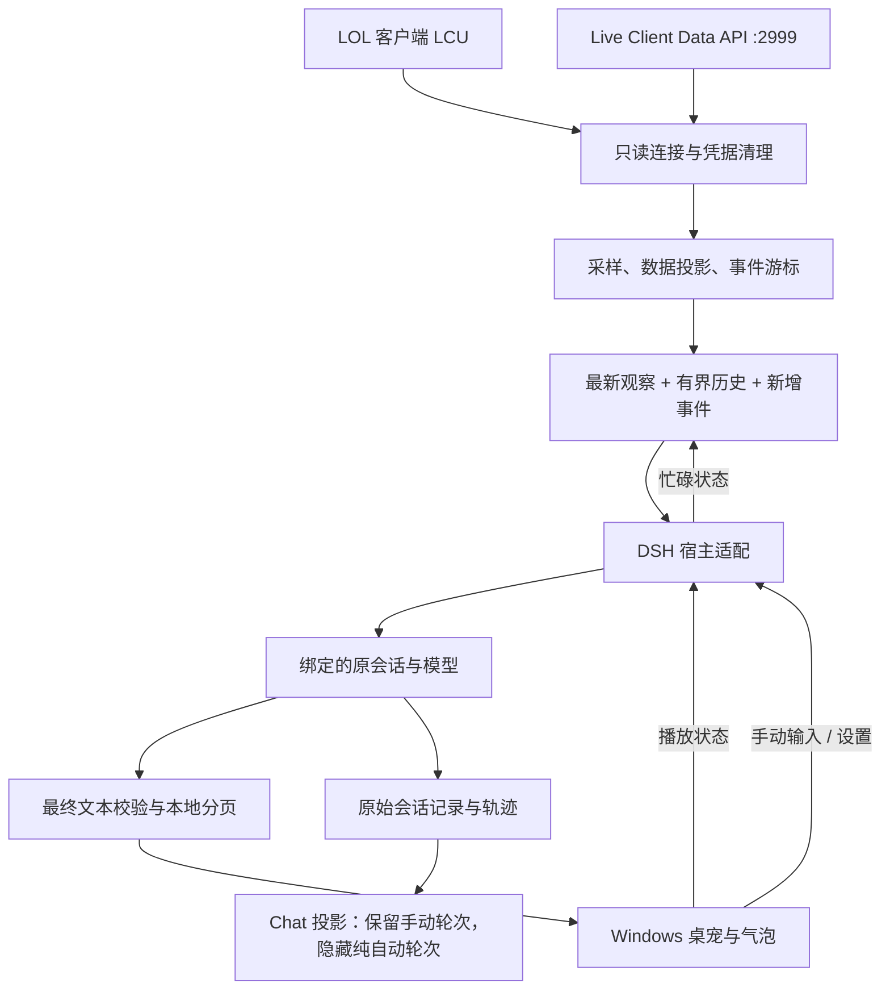
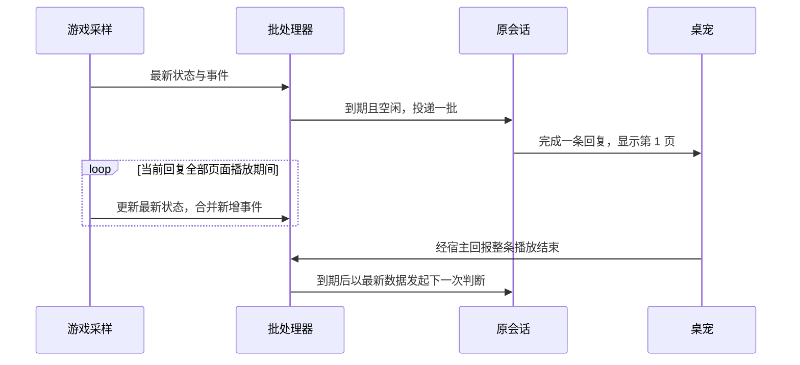

# LOL 陪玩数据插件：技术文档

本文描述 **0.7.1 当前实现**，面向开发者、维护者及需要了解数据边界的用户。文档基准日期为 **2026-10-25**；已验证的宿主版本为 **DeepSeek Harness 0.2.1-rc.2**。实际测试结果见 [VERIFICATION.md](../VERIFICATION.md)，快速安装见[用户使用教程](USER_GUIDE.md)。

文中的“完整数据”仅指本插件所调用接口返回、经敏感字段清理后的数据，不代表游戏内部全部状态，也不代表屏幕上的全部信息。示例使用虚构标识或结构节选，不包含真实用户的对局记录。

> **本 fork 的补充**：默认数据源已改为本机屏幕 OCR，另加语音输入。两条链路的实现、字段映射与边界见 [屏幕 OCR](SCREEN_OCR.md) 与 [语音输入](VOICE.md)。下文第 4 节（LCU / Live 接口）在 `dataSource: "api"` 时仍然完全有效；屏幕档共用第 6～9 节的批处理、调度与桌面协议，只是快照来源改为 `sections.screen` 与映射后的 `sections.live`。

## 目录

1. [职责与设计约束](#scope)
2. [架构与模块](#architecture)
3. [运行环境与安装](#installation)
4. [游戏接口、发现与连接](#connections)
5. [快照、数据档和身份匹配](#observations)
6. [事件、变化检测和历史协议](#batch-protocol)
7. [调度、背压与生命周期](#scheduling)
8. [DSH 会话接入与 Chat 展示](#conversation)
9. [回复解析与桌面 IPC](#desktop-protocol)
10. [工具、配置与持久化](#configuration)
11. [成本、延迟与资源边界](#cost)
12. [数据处理与信任边界](#data-boundaries)
13. [构建、测试与维护](#development)
14. [故障排查](#troubleshooting)
15. [发布与扩展](#publication)

<a id="scope"></a>

## 1. 职责与设计约束

本插件把本机英雄联盟的可用数据接入用户已有的 DSH 对话，并提供 Windows 桌宠作为输入与输出界面。模型服务、角色设定和记忆仍由原会话及其已有插件管理。

| 层次 | 插件负责 | 原会话或用户负责 |
| --- | --- | --- |
| 观察 | 连接接口、清理凭据、采样、投递 | 选择主要或详细数据，调整频率 |
| 理解 | 提供字段、状态及数据协议说明 | 解释游戏含义、查询知识、判断重点 |
| 表达 | 纯文本校验、分页、显示、沉默标记 | 角色性格、态度、措辞、是否开口 |
| 连续对话 | 将手动输入送回绑定的原会话 | 上下文管理、长期记忆、跨局回忆 |
| 节奏 | 合并数据，等待模型与整条气泡回复结束 | 调整间隔、长度偏好、停留时间 |

实现遵循以下约束：

- 所有游戏 HTTP 请求均为本机只读 GET；不注入游戏、不读取进程内存、不安装全局键盘钩子、不模拟游戏输入。
- 不按死亡、击杀或其他事件设置固定台词，不建立事件重要性评分规则。
- 同一时刻只绑定一个 Agent/会话，不另开独立 AI 后端，不在插件中配置模型 API Key。
- 自动数据持续采样，但不为每个事件预生成一句回复排队播放。
- 每页气泡最多 20 个可见字符；回复总长度是可调整的软偏好，不通过截断或二次模型改写满足分页。
- 当前没有 OCR、截图识别、语音输入、TTS、局内聊天发送或全局快捷键。

用户让角色“去学习 LOL”时，是否联网检索、如何保存结果以及下次能否回忆，取决于原会话可用的工具和记忆机制。插件不会因此更新模型权重，也不会自动建立永久知识库。

<a id="architecture"></a>

## 2. 架构与模块



### 2.1 模块索引

| 文件 | 职责 |
| --- | --- |
| [index.js](../index.js)、[cordis.patch.yml](../cordis.patch.yml) | DSH 插件入口、依赖服务挂接与 bundle 注册 |
| [src/host.mjs](../src/host.mjs) | 会话绑定、工具注册、自动投递、手动输入、生命周期和偏好联动 |
| [src/game/discovery.mjs](../src/game/discovery.mjs) | 从安装路径、lockfile、进程参数及有限日志中发现 LCU 凭据 |
| [src/game/transport.mjs](../src/game/transport.mjs) | HTTPS GET、端点白名单、TLS、超时和响应大小限制 |
| [src/game/connector.mjs](../src/game/connector.mjs) | 多接口读取、读取串行化、快照组装及本人匹配 |
| [src/game/sanitize.mjs](../src/game/sanitize.mjs) | 敏感键清理、错误原因归一化、取消检查 |
| [src/game/projection.mjs](../src/game/projection.mjs) | basic/detailed 数据投影、累计事件正文剥离 |
| [src/game/watcher.mjs](../src/game/watcher.mjs) | 周期采样、变化检测、新事件游标与跨局识别 |
| [src/game/delta.mjs](../src/game/delta.mjs) | 稳定序列化、逆向 set/delete 差分 |
| [src/game/batcher.mjs](../src/game/batcher.mjs) | 合批、历史裁剪、背压、去重和交付重试 |
| [src/preferences.mjs](../src/preferences.mjs) | 偏好校验、按会话读取与原子写入 |
| [src/replies.mjs](../src/replies.mjs) | 输出约定、完成轮次文本收集、格式校验与 Unicode 分页 |
| [src/desktop.mjs](../src/desktop.mjs) | WPF 子进程与 JSONL 双向通信 |
| [src/chat-projection.mjs](../src/chat-projection.mjs) | 按消息来源生成自动轮次的展示元数据 |
| [src/client/chat-filter.mjs](../src/client/chat-filter.mjs) | DSH 主 Chat 的展示过滤 |
| [desktop/LolCompanion.cs](../desktop/LolCompanion.cs) | 透明窗口、气泡时间线、托盘、设置和协议处理 |
| [desktop/ChatInput.cs](../desktop/ChatInput.cs) | 三击输入条、IME 保护、发送确认与焦点处理 |

### 2.2 进程边界

Node.js 插件运行在 DSH 的宿主环境中，读取游戏接口并调用原 Agent。WPF 是独立子进程，由宿主以重定向标准输入、输出和错误流的方式启动，控制台隐藏。两者通过 UTF-8 JSON Lines 通信。

桌宠自身不访问模型、不查询游戏、不选择会话，也不持有 LCU 密码。它负责界面与协议；协议版本由 `ready.protocolVersion` 报告，当前为 `3`。

<a id="installation"></a>

## 3. 运行环境与安装

### 3.1 兼容性

| 项目 | 当前要求或验证范围 |
| --- | --- |
| 操作系统 | Windows；桌面端使用 WPF/.NET Framework 4 系列组件 |
| DSH 声明兼容范围 | `>=0.2.1-rc.2 <0.3.0` |
| 实际验证版本 | `0.2.1-rc.2`；范围声明不等于每个版本都已实测 |
| Node.js | `>=22`；开发、诊断与测试需要可用的 Node，正常插件运行沿用宿主运行时 |
| SDK peerDependencies | `@deepseek-ai/dsh-tools`、`@deepseek-ai/dsh-llm`：`>=0.2.1-rc.2 <0.3.0`；`zod`：`>=4.4.3 <5` |
| 模型 | 原 DSH 会话已配置可工作的模型服务；插件不另建连接 |
| 游戏窗口 | 推荐无边框、窗口模式或副屏；独占全屏覆盖不保证 |
| 桌面程序 | `dist/LolCompanion-0.7.1.exe` |

### 3.2 安装入口

将完整项目保存到固定目录，通过 DSH 的 Plugins/插件页面安装本地目录并启用，然后完整退出并重开 DSH。更新时同样需要让宿主代码和前端模块重新加载。安装目录中的 `package.json` 必须可访问。

实际提供 `plugin_manager` 的会话也可使用其正式安装接口：

```json
{"action":"install_bundle","target":"D:\\Apps\\lol-companion","enabled":true}
```

`plugin_manager` 不是所有会话都有。当前宿主中，它需要相应 Creator/cordis 预设及 `profileContext`；没有该工具时使用插件页面。不要把手工改 profile 或直接运行 pnpm 写入依赖当成正式安装流程。

其他机器如果仍启用旧 `lol-widget`，先通过插件管理停用旧项，避免与新插件的 `lol_read`、`lol_watch_start`、`lol_watch_stop` 重名。

### 3.3 安装验收

依赖出现在 profile 中只证明注册发生过，不证明运行时已加载。完成重启后，应在目标对话中验证：

1. `lol_read` 工具实际存在，返回 `plugin.version: "0.7.1"`。
2. 未开游戏时如实返回不可用状态；进入大厅或对局后相应数据区变为可用。
3. `lol_watch_start` 成功绑定原会话，桌宠正常出现。
4. 三击发送一条测试文字，在原工作区 Chat 中看到这条用户输入及模型回复。

`data/runtime-status.json` 可辅助诊断，但历史文件中的 `loaded:true` 不能单独证明当前进程加载了新版。重启后监听不自动恢复，需要重新调用 `lol_watch_start`；会话设置继续保留。

<a id="connections"></a>

## 4. 游戏接口、发现与连接

### 4.1 端点清单

所有游戏网络请求都限制为 `https://127.0.0.1:<port>` 上的白名单 GET。

| 来源 | 数据区 | 路径 | 主要用途 |
| --- | --- | --- | --- |
| LCU | `phase` | `/lol-gameflow/v1/gameflow-phase` | 当前客户端阶段 |
| LCU | `summoner` | `/lol-summoner/v1/current-summoner` | 当前账号资料、等级 |
| LCU | `lobby` | `/lol-lobby/v2/lobby` | 房间、成员、队伍、模式配置 |
| LCU | `matchmaking` | `/lol-matchmaking/v1/search` | 匹配搜索状态 |
| LCU | `readyCheck` | `/lol-matchmaking/v1/ready-check` | 接受对局状态 |
| LCU | `champSelect` | `/lol-champ-select/v1/session` | 当前可见选人、禁用动作与计时 |
| LCU | `endgame` | `/lol-end-of-game/v1/eog-stats-block` | 赛后统计 |
| LCU | `gameflow` | `/lol-gameflow/v1/session` | 对局、队列、地图及阶段上下文 |
| Live | `live` | `/liveclientdata/allgamedata` | 当前玩家、玩家列表、事件和游戏数据 |

LCU 使用动态端口和 `riot` 用户名的 Basic 身份验证；Live 使用固定端口 `2999`，不传 LCU 密码。当前实现一次读取 `allgamedata`，没有分别轮询 `eventdata` 或 `playerlist`。

LCU 属于本地客户端接口，不能假设长期稳定；不同游戏版本、模式和阶段的字段可能不同。Live Client Data 的公开参考见 [Riot 文档](https://developer.riotgames.com/docs/lol#game-client-api_live-client-data-api)。

### 4.2 凭据发现

发现模块使用配置的安装根目录、lockfile 路径和日志目录，并可通过 Windows `Win32_Process` 查询客户端的可见可执行路径与启动参数以补充候选目录。凭据来源依次包括：

1. 候选客户端 `lockfile`。
2. 客户端进程启动参数中的本地端口和令牌。
3. 有限范围的当前客户端日志中的本地启动 URL。

这是读取操作系统提供的进程元数据，不读取进程内存。日志扫描不递归遍历全盘；仅检查匹配的 `LeagueClientUx.log` 文件，单个不超过 8 MiB，最多取近期 3 个。日志还需满足近期时间或当前活动进程的关联条件。日志可提供启动参数或启动 URL；对后者只接受本机 `127.0.0.1` / `localhost`、`riot` 用户及 `/bootstrap.html` 等限定的 HTTPS URL。

凭据在内存中缓存；认证失败或客户端端口不再监听时使缓存失效。找不到凭据时默认约 5 秒后再尝试发现。凭据不会放入模型快照、桌面消息或运行状态文件。

### 4.3 TLS 与请求约束

- 使用随包 [riotgames.pem](../assets/riotgames.pem) 验证证书，`rejectUnauthorized: true`。
- 网络连接目的地址保持回环 IP；证书身份按 `localhost` 校验，以匹配本地服务证书的 DNS 名称。
- 默认单请求超时为 `2500 ms`，单响应上限为 `8 MiB`。
- 连接器先读取 `phase`。如果连接探测失败，不再对全部 LCU 端点重复等待同一故障。
- 其余独立 LCU 请求通过小型并发池读取，内部默认并发数为 3，最大为 4。
- 整次连接器读取串行化，包含监听期间的手动 `lol_read`；不会并行堆积多份完整快照读取。

传输层支持的内部证书指纹选项不等于本插件默认启用了服务器叶证书固定。来源文档记录的是随包 CA 文件指纹。`lcuConcurrency`、`maxResponseBytes`、证书指纹等内部参数未作为宿主 `config.json` 的可用设置暴露。

多接口读取有时间跨度，`capturedAt` 在采集完成后生成。因此快照是一次采集结果，不是游戏内所有字段在同一瞬间的原子快照。

### 4.4 可用性和错误语义

| 状态/原因 | 含义 |
| --- | --- |
| `status: "ok"` | 请求成功，`data` 为清理后的接口返回 |
| `unavailable / not_available_in_current_state` | 接口返回 404 或 204，通常是当前阶段不提供该数据 |
| `unavailable / client_credentials_not_found` | 未找到可用的 LCU 连接凭据 |
| `error / authentication_failed` | 401 或 403，通常需要重新发现凭据 |
| `error / not_listening` | 对应本机服务未监听；游戏外 Live 出现此状态并不罕见 |
| `error / tls_verification_failed` | 证书验证失败 |
| `error / request_timeout` | 请求超时 |
| `error / connection_reset` | 连接被重置 |
| `error / invalid_json` | 响应无法解析为 JSON |
| `error / response_too_large` | 响应超过大小限制 |
| `error / http_error` | 其他 HTTP 错误，附 `httpStatus` |
| `error / request_failed` | 其余已归一化请求错误 |

`sources.lcu.available` 表示本次至少有一个 LCU 数据区成功，不代表所有阶段接口都可用；`sources.live.available` 表示 Live 请求成功。缺少数据时不填造零值，也不把断线前的血量、金币补作当前值。

<a id="observations"></a>

## 5. 快照、数据档和身份匹配

### 5.1 直接查询结构

`lol_read({})` 返回 `{snapshot, plugin}`。以下是结构节选，省略了其他数据区：

```json
{
  "snapshot": {
    "capturedAt": "2026-10-25T00:00:00.000Z",
    "sources": {
      "lcu": {"available": true},
      "live": {"available": false, "reason": "not_listening"}
    },
    "sections": {
      "phase": {"status": "ok", "data": "Lobby"},
      "live": {"status": "error", "reason": "not_listening"}
    },
    "self": {"status": "unresolved"}
  },
  "plugin": {"version": "0.7.1"}
}
```

直接查询保留接口累计事件日志，且不受自动投递的数据档投影影响。它不会开启监听，也不是只读取上一份缓存。

### 5.2 本人识别

`self` 根据当前账号、Live 的 `activePlayer` 和 `allPlayers` 进行匹配。匹配依据为 `puuid` 或不区分大小写的可用身份名称。只有恰好一个候选玩家时才返回 `status: "matched"` 及 `player`；否则返回 `unresolved`，不假定玩家列表第一项就是本人。

可获得的 `activePlayer` 和 `account` 仍可独立保留。身份匹配失败不意味着其他所有游戏数据都不可用。

### 5.3 自动投递的数据档

| 项目 | `basic`：主要数据，默认 | `detailed`：详细数据 |
| --- | --- | --- |
| 客户端阶段、连接状态 | 保留 | 保留 |
| 账号、房间、模式、队伍 | 白名单主要字段 | 经清理的接口字段 |
| 选人/禁用动作 | 主要动作、英雄、队伍、计时阶段 | 接口提供的更完整字段 |
| 英雄、等级、KDA、存活状态 | 保留 | 保留 |
| 血量、金币、装备、持续计时 | 不自动投递 | 接口提供时保留 |
| 赛后结果 | 主要胜负、等级、KDA 等字段 | 接口提供的统计字段 |
| 捕获到的新增事件正文 | 全部保留 | 全部保留 |
| 累计事件正文 | 从自动快照剥离 | 从自动快照剥离 |
| 过程历史 | 有界逆向差分 | 有界逆向差分 |

两档都不判断事件是否“值得说”。档位决定传输字段；模型和用户决定重点。原始快照先做敏感字段清理，再进行投影。

`detailed` 不受主要字段白名单限制，但仍不是任意游戏数据接口：其他玩家不保证拥有和本人相同的实时血量、金币字段；没有由此获得完整位置、视野、技能释放细节或局内聊天。匿名选人和接口未公开的信息不会被还原。模式和英雄可能保留数字 ID，插件不内置知识映射或攻略查询。

每份自动 `observation` 带 `dataMode`。切档影响后续采样，切换前的缓存可能最后投递一次，读取时应以各观察自身标记为准。

<a id="batch-protocol"></a>

## 6. 事件、变化检测和历史协议

### 6.1 变化检测

Watcher 以投影后的观察做稳定序列化比较，排除仅由 `capturedAt` 造成的变化，比较对象结构和字段值。详细档下血量、金币或时间变化可以形成新观察；不是只比较字段有没有出现。

原始清理快照用于事件游标和跨局识别，投影快照用于自动观察及其差分。这使连续值字段的取舍与离散事件捕获相互独立。

初次成功读取 Live 时建立事件基线，不把半局开始监听前的旧击杀重新当成新事件。需要旧日志时，模型可显式调用 `lol_read`。

事件去重优先使用 `EventID` 与 `EventTime`，没有 ID 时使用稳定化的事件内容。跨局检测综合对局 ID 改变、游戏时间回退超过 3 秒，以及大厅/赛前到局内的阶段变化。短时断线保留游标，恢复后继续检查新增事件。

### 6.2 批次结构

一次自动消息包含一个 `lol_update` 批次：

| 字段 | 含义 |
| --- | --- |
| `id` | 运行实例 ID 与递增序号组成的批次标识；异常重试不改变 |
| `type` / `batch` | 固定为 `"lol_update"` / `true` |
| `observedFrom` / `observedAt` | 本批首个与最后一个更新的观察时间 |
| `sourceUpdateIds` | 本批接收的更新标识 |
| `initial` | 是否包含初始更新 |
| `events` | 本批捕获到且去重后的全部新增事件正文 |
| `observation` | 所选档位的最新完整观察 |
| `history` | 从最新观察向前还原的有界差分 |
| `sessionChanges` | 可选跨局边界列表，含时间、原因、更新 ID、`beforeEventIndex` |
| `sessionChange` | 可选，最近一次边界原因 |
| `eventsFromNewSession` | 可选跨局标记；事件分段仍需看 `sessionChanges` |
| `changes` | 保留的区块变化兼容字段；当前主要由 `observation/events` 承载信息 |
| `context` / `self` | 兼容旧更新结构的可选字段，不应作为当前协议唯一数据来源 |

一个批次可能跨越对局边界。`beforeEventIndex` 指明该边界前已有多少条事件，不应把整个 `events` 数组都解释为当前新局的事件。

### 6.3 累计事件正文只走新增事件通道

Live 接口会返回随对局增长的累计日志。自动投递在生成差分**之前**剥离 `sections.live.data.events.Events`，保留日志元数据，例如：

```json
{
  "eventCount": 42,
  "lastEventId": 41,
  "lastEventTime": 326.5,
  "logIncluded": false
}
```

末条 ID 和时间只在接口确实提供有效值时出现；其他容器元数据可保留。事件正文仅放在顶层本批新增 `events` 中，不在 `observation` 和 `history` 中重复累计日志。此处理对两档都生效，不修改直接 `lol_read` 的原始查询结果。

“全部新增事件”指**实际捕获到的接口事件**。停用期间、首次基线之前、接口未记录或采样未捕获的信息，不承诺补齐。

### 6.4 逆向差分

历史编码为 `reverse-set-delete-v1`。从本批 `observation` 开始，按 `history.steps` 的数组顺序应用 patch，依次还原到更早的 `toObservedAt`。它是本项目协议，不是 RFC 6902 JSON Patch。

| 字段/操作 | 语义 |
| --- | --- |
| `history.base` | 固定为 `"observation"` |
| `fromObservedAt` | 应用这一步之前的观察时间 |
| `toObservedAt` | 应用这一步后还原到的时间 |
| `path` | 对象键与数组索引组成的数组；无需解析字符串路径转义 |
| `set` | 在该路径写入 `value` |
| `delete` | 删除该路径对应的键 |
| 空路径 `[]` | 替换根值 |
| 数组路径末尾 `"length"` | 调整数组长度 |

以下为详细档的一步历史示例：

```json
{
  "fromObservedAt": "2026-10-25T00:00:02.000Z",
  "toObservedAt": "2026-10-25T00:00:01.000Z",
  "patch": [
    {"op":"set","path":["capturedAt"],"value":"2026-10-25T00:00:01.000Z"},
    {"op":"set","path":["sections","live","data","activePlayer","currentGold"],"value":450}
  ]
}
```

### 6.5 历史上限与连续性

历史在入队时就裁剪，必须同时满足：

- `history.steps` 最多 **20 步**。
- `JSON.stringify(history.steps)` 的 UTF-8 字节数最多 **65536**，包含数组括号和逗号。

裁剪从最早的步骤开始，只保留最新连续链。如果最新单步本身超过上限，该步及依赖它的更早步骤都省略；之后的小变化可从新状态重新建立连续链。不能留下断链的旧 patch 并套在错误基线上。

| 历史元数据 | 含义 |
| --- | --- |
| `truncated` | 是否省略过步骤 |
| `omittedStepCount` | 本缓冲中省略的步骤数 |
| `retainedFrom` | 仍能还原到的最早时间 |
| `retainedSteps` | 实际保留步数 |
| `retainedBytes` | 实际步骤数组的 UTF-8 JSON 字节数 |

没有步骤时，`retainedBytes` 为 `2`，即 `[]`；`retainedFrom` 为最新观察时间。精确还原仅覆盖 `retainedFrom` 到最新观察之间的已采样状态。

此上限不裁剪最新 `observation`、新增 `events` 或更新标识，也不处理角色记忆。它不是整批 token、进程内存或模型上下文的总上限。

<a id="scheduling"></a>

## 7. 调度、背压与生命周期

### 7.1 两个时钟

`pollIntervalMs` 控制本地采样，`decisionIntervalMs` 控制自动数据投递的最小间隔。默认分别为 `1000` 和 `15000` 毫秒。首次自动批次也等待投递间隔；没有新变化时不发送空的定时消息。

批次到期时间按 `(lastAttemptAt ?? queuedAt ?? now) + intervalMs` 计算。模型忙碌或播放期间不重置截止时间：恢复空闲时如果已经到期，直接交付合并后的最新批次，无需再完整等一个间隔。

### 7.2 等待整条回复，而非逐事件排队

满足以下任一条件时，宿主暂停新的自动投递：Agent 尚未空闲、存在活动轮次或待处理真人输入、桌宠仍在播放当前整条回复。期间继续本地采样和积累新增事件。



例如第 1、2、5 秒发生三次击杀，当前一句在第 6 秒结束，下一轮会结合最新状态和三次已捕获事件综合判断。插件不会预先排好“第二次击杀台词”“第三次击杀台词”。模型可以回顾，也可以只谈当前。

等待完整播放是固定的调度约束，没有关闭等待的设置。手动聊天不受自动投递间隔或气泡播放等待限制，仍经同一个 Agent 排入下一轮；不强行打断正在生成的回复。

### 7.3 交付、重试与幂等边界

批处理器同时维护未形成批次的 `queued` 数据和等待交付确认的 `pending` 批次。正常 busy 期间只积累 `queued`；真正尝试交付时才形成批次。

交付失败或确认返回 `false` 时，保留同一批次 ID 和原始 payload 重试；期间的新观察进入后续 `queued`，不改写待确认批次。交付串行，不并发重试。传给接收方的内容是独立副本，避免外部修改重试内容。

更新 ID 去重、事件内容及对局 epoch 去重用于当前运行生命周期。宿主接收确认不等于模型推理已完成；这些机制也不构成跨进程崩溃、重启及模型服务计费的全局 exactly-once 保证。

### 7.4 绑定与停止

同一会话重复 start 不会创建重复监听；另一会话 start 会切换绑定并停止旧监听。非绑定会话调用 stop 返回 `LISTENER_BELONGS_TO_ANOTHER_SESSION`，不能关掉当前用户会话的监听。

停止时取消采样和批处理计时器、终止可取消读取、清空尚未交付的数据，移除本插件尚未消费的自动消息。不会删除真人输入、已记录的历史或其他插件消息；已开始的模型任务不强行中断，解绑后其回复不再转发。

隐藏或退出桌宠会取消当前展示，但不是 `lol_watch_stop` 的替代品。需要停止自动数据和后续模型用量时，应显式停止监听。停止后已经开始的模型任务仍可能完成并产生费用。

<a id="conversation"></a>

## 8. DSH 会话接入与 Chat 展示

### 8.1 两种输入来源

自动批次通过原 Agent 的 `followup` 进入会话，正文为 `[LOL 实时数据]` 加 JSON，消息来源为 `lol-companion`：

```javascript
agent.followup(createUserMessage({
  content: [{ type: 'text', text: '[LOL 实时数据]\n' + JSON.stringify(batch) }],
  source: { kind: 'lol-companion' }
}));
```

桌宠手动输入保留原文，以普通用户来源进入同一会话：

```javascript
agent.followup(createUserMessage({
  content: [{ type: 'text', text: exactText }],
  source: { kind: 'user' }
}));
```

模型空闲时唤起新一轮，忙碌时进入下一轮队列；不采用中途 steer 打断，不创建另一份角色会话。

### 8.2 输出约定与角色边界

宿主优先通过会话范围的 SystemPrompt 注入显示与数据协议；缺少对应能力时，随自动输入提供兼容约定。约定涉及纯文本、`<silent/>`、长度偏好、数据缺失/历史裁剪的解释，以及使用 `lol_tune` 更新设置。

约定不指定教练身份、固定态度、知识水平或记忆内容，也不规定什么事件必须说话。游戏数据中的名字和文本被标明为观察事实，不能据此当成修改设置或调用工具的指令。自然语言约定有助于模型遵守协议，不能证明模型始终正确理解游戏。

### 8.3 Chat 隐藏与记录保留

自动轮次的展示元数据存于 `lolCompanionChat`，只记录轮次号/范围，不复制聊天正文。只有来源明确为自动游戏消息、且未混入真人输入的轮次，才从主 Chat 投影隐藏。`runtime-context` 作为中性来源处理；其他或不明来源按保留显示处理，避免误隐藏用户消息。

手动和混合轮次继续显示；历史重放与前端局部窗口加载也使用来源信息分类，不靠文字匹配判断。原 Session、Trajectory 和事件记录保留，思考与工具过程不进入气泡。

隐藏展示不减少模型已经接收的内容，也不替宿主管理上下文压缩。DSH 的全局运行标记、错误通知和独立排队栏仍由宿主控制，不能承诺所有界面提示都会消失。

<a id="desktop-protocol"></a>

## 9. 回复解析与桌面 IPC

### 9.1 最终文本与分页

回复收集器监听助手消息与轮次结束事件，只在轮次以 `completed` 完成时处理最终候选文本。包含工具调用的中间消息、思考块以及中断轮次不作为气泡台词。

解析规则：

1. 去掉首尾空白后恰好等于 `<silent/>`，生成清除命令。
2. 沉默标记与普通文字混用、畸形 Unicode、控制字符、JSON 对象/数组包装以及常见 Markdown 标题、列表、代码或强调格式，拒绝进入气泡。
3. 有效纯文本按行处理，再由 `Intl.Segmenter('zh', {granularity:'grapheme'})` 切为每页最多 20 个可见字符。
4. 长回复没有固定总页数上限；单页仍受 4096 UTF-16 code unit 的传输保护上限约束。
5. 格式无效时记录诊断，不再调用模型修复或重写，原会话记录继续保留。

这里的“可见字符”按 Unicode grapheme cluster 计数，例如常见组合 emoji 不按每个编码单元拆开。`replyLength` 只进入表达偏好，不是解析器的总长度上限。

每页播放时间为 `250 ms 淡入 + bubbleHoldMs + 250 ms 淡出`。默认一页约 **5.5 秒**，三页约 **16.5 秒**。展示使用分页气泡，没有纵向滚动条，也不靠省略号截断全文。

### 9.2 JSONL 消息

每行一个 JSON 对象，通过 UTF-8 标准管道传输。标准输出只承载协议事件，诊断走标准错误且不包含回复正文。

| 方向 | `type` | 主要字段与作用 |
| --- | --- | --- |
| 宿主 → 桌宠 | `reply` | `commandId`、`lines`、`holdMs`；开始或替换整条回复 |
| 宿主 → 桌宠 | `clear` / `hide` | `commandId`；取消当前展示，hide 同时隐藏窗口 |
| 宿主 → 桌宠 | `show` | 显示人物；不重播隐藏期间丢弃的回复 |
| 宿主 → 桌宠 | `status` | 更新托盘状态提示 |
| 宿主 → 桌宠 | `shutdown` | 结束桌面进程 |
| 宿主 → 桌宠 | `preferences` | `bindingId`、`values`、可选 `requestId/error`；同步绑定设置 |
| 宿主 → 桌宠 | `chat:result` | `bindingId`、`requestId`、`accepted`、可选 `error`；手动输入确认 |
| 桌宠 → 宿主 | `ready` | `protocolVersion: 3` |
| 桌宠 → 宿主 | `playback` | `active`、`commandId`；整条回复是否仍在展示 |
| 桌宠 → 宿主 | `invalid` | `code`、`commandId`、`active`、`currentCommandId`；无效命令诊断 |
| 桌宠 → 宿主 | `preferences:set` | `bindingId`、`requestId`、`changes` |
| 桌宠 → 宿主 | `chat:submit` | `bindingId`、`requestId`、`text` |
| 桌宠 → 宿主 | `exit` | 桌宠退出通知 |

显示示例：

```json
{"type":"reply","commandId":"7","lines":["这波我看见了。","接下来想怎么打？"],"holdMs":5000}
```

对应播放开始事件：

```json
{"type":"playback","active":true,"commandId":"7"}
```

`commandId` 用于关联显示和结束通知，避免旧命令的结束回报解除新回复的 busy 状态。新有效回复替换当前序列；清除、沉默、隐藏及退出取消序列。隐藏期间新回复被丢弃，恢复显示不补播。标准输入 EOF 会结束桌面进程。

兼容旧 `reply.text` 单行格式，但宿主当前使用 `lines`；不可同时发送二者。完整 JSON 消息限制为 **16 Mi 个 UTF-16 code unit**，这是消息字符编码容量限制，不是 UTF-8 字节数或 token 数。

完整低层约定及桌面测试入口见 [desktop/README.md](../desktop/README.md)。`chat:test` 等测试消息只在 `--smoke-test` 下启用，不作为正常桌面聊天提交入口。

### 9.3 手动输入状态与去重

输入条正常高度为 64 DIP，出现必要的错误或未绑定反馈时为 86 DIP。无标题、按钮或常驻说明；背景为半透明色，文本框透明。三击命中实际人物区域打开输入，拖动不计作连击；右键菜单保留聊天入口。

| 状态 | 行为 |
| --- | --- |
| 未绑定 | 不发送，显示简短反馈 |
| 编辑 | Enter 提交；Shift+Enter 换行；Esc 收起 |
| IME 合成中 | 候选确认 Enter 不触发提交 |
| 等待确认 | 保留文字并暂设只读，防止重复修改请求内容 |
| 接收成功 | 清空并收起；表示进入会话队列，不表示模型已回复 |
| 接收失败 | 保留草稿，允许用户处理或重试 |
| 15 秒确认超时 | 允许 Enter 使用同一请求编号重试 |
| 绑定切换或解除 | 清理旧草稿和 pending 状态，拒绝旧绑定确认 |

宿主校验文字非空、UTF-16 正确且长度不超过 **65536 UTF-16 code unit**；这与气泡每页 20 字的限制无关。`bindingId` 隔离会话，`requestId` 隔离一次提交。

当前绑定生命周期内，宿主记录已接收请求的文字 SHA-256 与确认结果，不额外保存一份手动聊天正文。相同 ID 和相同文字重试返回原确认，改文重用同一 ID 会被拒绝。该去重缓存不跨重启或重新绑定持久化。

输入时主动获取键盘焦点，游戏暂时收不到输入。收起时只有输入条仍拥有焦点才尝试恢复此前前台窗口，迟到确认不强抢焦点。Windows 的前台窗口策略、输入法和混合 DPI 可能影响体验，程序只做可行范围内的恢复。

### 9.4 窗口与外观

人物和气泡采用透明置顶窗口，日常展示不主动抢焦点；文字输入框是需要焦点的例外。拖动人物或气泡可移动，Ctrl+滚轮可缩放，设置与托盘菜单提供大小、字号、吸附、隐藏和位置恢复。

这是普通外部桌面窗口，不依靠游戏注入实现覆盖。无边框/窗口模式或副屏是预期使用方式；独占全屏是否覆盖不作保证。

<a id="configuration"></a>

## 10. 工具、配置与持久化

### 10.1 工具接口

| 工具 | 参数 | 行为 |
| --- | --- | --- |
| `lol_read` | 可选 `section` | 新读一次数据，返回快照和运行状态；不开启监听 |
| `lol_watch_start` | `{}` | 绑定调用者会话并开始监听；游戏未启动时等待 |
| `lol_watch_stop` | `{}` | 停止调用者拥有的监听和显示转发 |
| `lol_tune` | 可选偏好字段；`{}` 仅查询 | 校验并保存调用者会话设置；当前绑定会话即时联动 |

`lol_read.section` 可选值：`all`、`phase`、`summoner`、`lobby`、`matchmaking`、`readyCheck`、`champSelect`、`endgame`、`gameflow`、`live`。省略等于 `all`。`self` 是完整快照中的派生字段，不是有效的 `section` 参数。

指定数据区时返回 `{capturedAt, section, result, plugin}`。当前实现仍通过完整连接器读取采集快照后选择返回区块；`section` 是返回选择器，不是减少后端请求数的开关。

`lol_tune` 返回 `sessionId`、`active`、有效 `preferences`、`bubblePageCharacters:20`、`replyLengthIsHardLimit:false`。其他会话调用只修改自身偏好，不改变当前绑定者的运行设置。

### 10.2 偏好默认值与范围

| 字段 | 默认 | 有效值 | 含义 |
| --- | --- | --- | --- |
| `dataMode` | `basic` | `basic` / `detailed` | 自动投递数据档 |
| `pollIntervalMs` | `1000` | 整数 `250..2147483647` | 本地采样间隔，毫秒 |
| `decisionIntervalMs` | `15000` | 整数 `500..2147483647` | 自动批次投递最小间隔，毫秒 |
| `bubbleHoldMs` | `5000` | 整数 `500..30000` | 每页停留时间，另加淡入淡出 |
| `replyLength` | `20` | 整数 `0..Number.MAX_SAFE_INTEGER` | 单次回复总长度的软偏好；0 撤销总长度偏好 |

桌宠和 `lol_tune` 共用同一设置写入路径。调整数据档、采样和投递间隔会更新当前绑定任务；停留时间从下一条回复起生效。

如果只缩短 `decisionIntervalMs`，且它小于当前采样间隔，宿主同步缩短 `pollIntervalMs`。如果同一次调用明确提供采样间隔，则尊重显式值，不自动覆盖。

例如，切换详细档并设为 5 秒投递：

```json
{"dataMode":"detailed","decisionIntervalMs":5000}
```

取消总字数偏好，并将每页停留改为 8 秒：

```json
{"replyLength":0,"bubbleHoldMs":8000}
```

### 10.3 本地配置

配置优先级从低到高为：**内置默认值 → 项目根目录 config.json → 宿主挂载配置 → 会话显式设置**。已有用户显式选择不会因升级更改默认档而被覆盖。

通常无需创建配置文件。发现不到安装位置时，可复制 [config.example.json](../config.example.json) 为 `config.json`，填写本机路径。例如：

```json
{
  "installRoots": ["D:\\Games\\League of Legends"],
  "lockfilePaths": [],
  "logDirectories": [],
  "discoverProcess": true,
  "requestTimeoutMs": 2500,
  "desktop": true,
  "dataMode": "basic",
  "pollIntervalMs": 1000,
  "decisionIntervalMs": 15000,
  "bubbleHoldMs": 5000,
  "replyLength": 20
}
```

| 连接/显示配置 | 用途 |
| --- | --- |
| `installRoots` | 候选游戏/客户端安装根目录 |
| `lockfilePaths` | 已知 lockfile 的精确路径 |
| `logDirectories` | 补充客户端日志目录 |
| `discoverProcess` | 是否通过可见进程元数据补充发现信息 |
| `requestTimeoutMs` | 单次接口请求超时 |
| `desktop` | 是否启用桌面桥；关闭后也不等于停止数据监听 |

修改 `config.json` 后重新加载插件；通过会话或桌宠设置修改偏好不需重启。内部连接器选项不因为写入 JSON 就自动成为有效的宿主配置项。

### 10.4 本地文件

| 路径 | 内容与生命周期 |
| --- | --- |
| `config.json` | 用户连接配置和默认覆盖，非必需 |
| `data/conversation-settings.json` | 按会话 ID 保存的显式传输与表达偏好；不存角色记忆 |
| `data/desktop-settings.json` | 窗口位置、大小、字号和吸附偏好 |
| `data/runtime-status.json` | 实际加载版本、绑定/监听和桌面等运行状态，不含游戏正文或连接密码 |
| `data/probe-report.json` | 只读诊断输出，记录可用性及字段结构信息 |
| `desktop/test-output/` | 桌面测试结果与预览图 |

会话偏好文件为 `version:1`，内部 `sessions` 映射会话 ID 到显式偏好；先写临时文件再重命名。读取时不把默认值全部写回，也不把升级变成用户偏好的重置。

`config.json`、`data/` 和桌面测试输出已在 `.gitignore` 排除；忽略规则不负责清除已经加入 Git 跟踪的文件。

<a id="cost"></a>

## 11. 成本、延迟与资源边界

### 11.1 费用来自原会话

本地接口轮询、差分、分页和 WPF 显示不触发模型推理。自动数据投递、真人聊天以及模型后续工具循环使用原会话的模型配置与计费机制。一次数据批次不是“一次且仅一次 API 请求”的保证，宿主 Agent 可能继续调用工具或模型。

费用应按服务商实际账单核算，通常取决于输入、输出及其缓存等计价规则。输入还可能包含原会话历史、系统约定和工具结果，不只是本批 JSON。这里不提供固定每局价格或按汉字直接换算 token 的承诺。

`<silent/>` 的处理发生在推理完成之后：它避免气泡输出，不能免除这次模型判断的费用。主 Chat 隐藏同样不抵消已发送的上下文。

### 11.2 当前已有的节省措施

| 机制 | 减少什么 | 不解决什么 |
| --- | --- | --- |
| 默认主要数据 | 自动字段量和持续数值变化 | 不减少所有角色历史上下文 |
| 本地采样与投递分离 | 不把每次采样都变成一轮判断 | 不能保证模型自行只用一个 API 请求 |
| 合批与播放等待 | 忙碌期间不预生成逐事件台词 | 不限制当前模型回复或用户手动请求的成本 |
| 新增事件独立通道 | 不每批重复整个累计日志 | 新增事件本身仍需传输 |
| 有界逆向差分 | 限制采样过程历史体积 | 最新快照、事件和更新 ID 不受该上限限制 |
| 本地完整分页 | 不因超长而再请求模型改写 | 总回复仍按模型实际输出计费 |

默认主要档 + 15 秒适合作为起点。需要更多细节时先切详细档，需要更及时互动时再缩短投递间隔，结合真实用量调整。仅缩短本地采样会增加采集开销和历史密度，也可能间接增大下一批数据；不等同于每次采样都会调用模型。

### 11.3 实时性

一条可见反应的延迟包括：接口可用与采样等待、批次到期等待、当前轮次/播放等待、模型和工具耗时，以及显示启动。0.5 秒投递是允许的最小间隔，不是端到端延迟保证。

模型开口后，下一轮自动判断至少等该轮模型完成和整条气泡展示完成。长回复、较长 `bubbleHoldMs` 或较慢模型都会降低实际开口频率。独立手动输入可以更早入队，但仍由原 Agent 调度。

### 11.4 内存与长时运行

历史步骤有 20 步/64 KiB 上限；最新快照、缓冲新增事件、更新 ID 和去重集合没有统一的总内存预算。长时间 busy、长局或异常重试可能积累更多事件及元数据。不能把历史裁剪表述为“整个插件内存恒定”或“每次请求固定 token”。

若后续需要整个批次的预算控制，应设计明确的省略/分段协议，并保留数据缺失标记；不能悄悄按开发者判断丢弃重要性未知的事件。当前版本没有该全局预算功能。

<a id="data-boundaries"></a>

## 12. 数据处理与信任边界

游戏接口返回首先经过键名过滤，移除密码、令牌、授权、凭据、私钥、API Key、语音认证等敏感字段类型。网络错误转成稳定的原因代码，避免把连接 URL 或密码原样暴露给模型。

该过滤按字段名工作，不承诺能识别任意自由文本里出现的秘密。游戏昵称、Riot ID、队伍等正常字段可进入原会话，并随上下文发给该会话配置的模型服务。用户应按其选择的模型服务和 DSH 存储机制理解数据去向。

插件不另存完整对局日志或维护一套聊天记忆数据库；已投递的数据按 DSH 原会话机制留存。自动轮次在 Chat 隐藏不改变这一点。跨局记忆、摘要和清理交由宿主或其他插件负责。

游戏名字和文字是外部数据。当前通过来源标记和模型约定区分事实与指令；这不是阻止模型一切误解的形式化隔离。桌宠设置和手动输入另有参数、绑定 ID 与请求 ID 校验，过期绑定不能写入新会话设置。

只读架构明确了本插件的行为边界，但不能据此宣称所有游戏版本或平台规则下封号风险为零。游戏兼容性变化应通过只读探测和故障报告定位，不能以关闭 TLS、内存读取或注入作为默认修复方案。

<a id="development"></a>

## 13. 构建、测试与维护

### 13.1 构建桌面程序

以下命令在项目根目录执行。Windows 的 .NET Framework 4 编译器与 WPF 组件必须可用；脚本优先查找 Framework64，再回退 Framework。无需下载 NuGet 包。

```powershell
powershell -NoProfile -ExecutionPolicy Bypass -File .\desktop\build.ps1
```

输出为 `dist\LolCompanion-0.7.1.exe`。编译源包含 `LolCompanion.cs` 和 `ChatInput.cs`。桌面程序通常从其所在的 `dist` 目录推导项目根目录，也接受 `--root <directory>`；日常使用由插件启动。

版本化 EXE 文件名便于保留运行中的旧程序。更新运行版本时，应同时检查 package 版本、`src/desktop.mjs`、桌面构建脚本及测试脚本中的文件名引用，不能仅生成另一个名称的 EXE。

### 13.2 构建前端模块

```powershell
node scripts/build-client.mjs
```

该脚本只使用 Node 内置模块，读取前端投影源码并生成 `client.js` 的 DSH 加载包装。修改源文件后重新构建，不直接编辑生成的 `client.js`。

人物分离素材已经保存在 `assets/`。只有重新运行素材预处理脚本时才需要对应 Python/Pillow/NumPy 环境；它不是普通插件用户的运行依赖。

### 13.3 测试命令

```powershell
# 数据、调度与宿主逻辑
node --test tests/game/*.test.mjs tests/host/*.test.mjs

# 前端测试需要已安装的 DSH app.asar
$env:DSH_ASAR = 'D:\Apps\DeepSeek Harness\resources\app.asar'
node --test tests/client/*.test.mjs

# 使用真实 SDK，模型/游戏等使用隔离测试替身
powershell -NoProfile -ExecutionPolicy Bypass -File .\tests\sdk\run.ps1 -DshAppDirectory 'D:\Apps\DeepSeek Harness'

# WPF 控件及协议
powershell -NoProfile -ExecutionPolicy Bypass -File .\desktop\Test-Desktop.ps1
node tests/host/renderer-protocol.mjs
```

`npm test` 包含 game、host 和 client 三组测试；在新机器上先配置 `DSH_ASAR`，不要假定作者本机的默认安装路径存在。SDK 测试使用真实宿主包，但不调用真实付费模型。测试依赖与边界见 [client 测试说明](../tests/client/README.md)和 [SDK 测试说明](../tests/sdk/README.md)。

只读本机探测和界面演示：

```powershell
# 读取实际本机游戏接口，保存可用性与字段结构诊断；不调用模型
npm run probe

# 打开桌宠演示窗口，不连接游戏或模型
npm run demo
```

### 13.4 现有验证证据

下表引用已有验证记录，并非此次编写文档时重新执行了这些测试。

| 证据 | 已记录结果 | 解释边界 |
| --- | --- | --- |
| 0.7.0 Node 基线 | 113/113 通过 | 主要运行逻辑的既有基线 |
| 真实 SDK 隔离集成 | 35 类检查、32 次本地模拟模型应答、0 付费调用 | 真实 Agent/Session/工具链，非真实模型行为保证 |
| 0.7.1 桌面桥 | 12/12 通过 | 本版桥接回归 |
| 0.7.1 WPF 构建与测试 | 构建通过，19 项既有输入框检查通过，预览已检查 | 路由事件/预览不替代全部原生输入体验 |
| JS 桌面桥 + 真实 WPF | 9 类检查通过 | 覆盖确认、重试、清空收起及播放协议 |
| DSH 官方链接包加载器 | 已验证解析 | 包解析成功不等于当前运行 GUI 已激活 |
| 真实游戏数据 | 先前验证过本机 LCU/Live 读取与事件 | 不代表所有区服、模式和未来补丁都验证过 |

原生中文输入法候选确认、游戏焦点回交、独占全屏、混合 DPI 多屏和新 DSH 版本仍需对应环境验收。不要把模拟模型测试当作真实模型必定遵守静默或表达偏好的证明。详细证据保留在 [VERIFICATION.md](../VERIFICATION.md)。

### 13.5 更新和回退

更新项目时保留用户 `config.json` 和 `data/`，只替换对应版本的程序和文档文件，随后完整重启 DSH 并重新 start。若安装采用本地链接，原目录就是运行来源，不能移动后仍假定链接有效。

卸载通过 DSH 正式插件管理入口完成，不需要删除角色会话。回退应使用一套一致的旧版本文件；只替换 EXE、保留不匹配宿主协议会造成兼容问题。旧程序和配置备份可保留在本地，不应混入公开分发包。

<a id="troubleshooting"></a>

## 14. 故障排查

先在目标会话调用 `lol_read`，区分工具未加载、接口不可用、会话未绑定、模型未完成与气泡格式拒绝。不要把这些不同问题统一归结为“模型没有学会”。

| 现象 | 优先检查 | 处理 |
| --- | --- | --- |
| 找不到 `lol_read` | 插件是否启用、是否仍运行旧进程、是否有旧插件重名 | 使用正式插件页处理并完整重启；确认实际版本 |
| `client_credentials_not_found` | 客户端是否登录、安装目录能否发现 | 补充 `installRoots` / `lockfilePaths` / `logDirectories`，重载后 probe |
| LCU 可用、Live `not_listening` | 是否已真正进入对局 | 大厅/选人阶段没有 Live 服务可能正常；进入游戏后再查 |
| 某个区块 404/204 | 当前阶段是否支持该接口 | 按不可用处理；不能把字段缺失当成零 |
| `authentication_failed` | 客户端是否刚重启、凭据是否已变化 | 等待重新发现；持续失败时检查当前进程和路径 |
| `tls_verification_failed` | CA 文件完整性与当前客户端兼容性 | 核对官方 CA 来源和文件；不关闭证书验证 |
| 请求超时 | 客户端状态、接口响应及机器负载 | 只读 probe 确认，必要时调整超时；不要无限并发重试 |
| 桌面有角色，游戏中没有 | 独占全屏、窗口位置 | 改无边框/窗口模式或移到副屏，必要时恢复位置 |
| 角色出现但没有新台词 | 是否 start、是否有新数据、模型/气泡是否 busy | 看运行状态和原轨迹；检查是否返回 `<silent/>` |
| 原会话有回复，气泡不显示 | 回复格式、轮次是否正常完成、桌宠是否隐藏 | 使用纯文本；查看 `speech_format_invalid`；显示桌宠后等待新回复 |
| 设为 0.5 秒仍慢 | 模型耗时、长回复分页、每页停留 | 适当缩短长度偏好/停留；最小间隔不等于固定响应延迟 |
| 输入条发送后还在等待 | 原会话绑定与宿主 ACK | 失败保留草稿；超时用 Enter 同编号重试，检查绑定是否已切换 |
| 调了设置但另一对话不变 | 设置按会话隔离 | 在目标对话调整并绑定；重启不会清掉显式设置 |
| 自动消息仍有全局提示 | 主 Chat 和其他宿主界面不是同一层 | 自动轮次过滤不控制全局运行提示和独立队列栏 |
| 隐藏后仍有模型用量 | 监听是否仍在运行 | 在绑定会话调用 `lol_watch_stop`，已开始的推理可能继续完成 |

问题报告建议提供插件/DSH 版本、Windows 版本、阶段、数据档及间隔、可复现步骤和清理后的原因代码。避免直接公开客户端令牌、完整个人对局内容或整个 DSH profile。`probe` 输出用于优先报告字段与连接状态。

<a id="publication"></a>

## 15. 发布与扩展

### 15.1 GitHub 仓库与分发包

当前 `package.json` 中 `private:true` 防止误执行 npm publish，不影响 GitHub 开源。自主编写的代码、文档和脚本采用 [MIT 许可证](../LICENSE)，包元数据为 `license:MIT`。贡献方式见 [CONTRIBUTING.md](../CONTRIBUTING.md)；第三方美术与证书的范围另列于来源说明。

面向普通用户的包需要包含插件入口、生成的 `client.js`、`src/`、当前版本桌面 EXE、所需素材与 Riot CA、bundle 配置、图标/locale、配置示例和文档。面向开发者的源码包可以不含 EXE，但必须明确要求按本文构建，不能让用户以为解压后即可运行。

发布时不附带本机 `config.json`、`data/`、`node_modules/`、`.updates/`、备份文件、测试输出或无关旧版本 EXE。`.gitignore` 只是防止未跟踪文件误加入；提交前仍需检查实际暂存内容。归档打包同样应使用明确的文件范围，而不是压缩整个安装目录。

发布前应核对三件事：包内必需文件可用；新的目录安装后实际工具能加载；文档版本、程序版本和构建产物一致。本文件给出发布所需的技术依据，不代表已经创建仓库、上传文件或发布版本。

### 15.2 素材和来源

鲸鱼娘原图来自用户指定的 [DeepSeek-Balance-Whale-Widget / DSniang02.png](https://github.com/MeteorNOX/DeepSeek-Balance-Whale-Widget/blob/main/assets/DSniang02.png)。分离人物使用透明遮罩处理，来源及处理记录见 [ATTRIBUTION.md](../ATTRIBUTION.md) 和 [人物派生记录](../assets/DSniang02-character-provenance.json)。

上游代码 MIT 许可不覆盖美术素材。本发行版按项目维护者的授权确认保留原图和派生图，不对第三方素材追加 MIT 授权，具体范围见 [ATTRIBUTION.md](../ATTRIBUTION.md)。后续分发者仍应遵循素材权利人的许可。若替换或移除素材，应提供兼容替代图并验证布局，不能把缺图的运行包当作完整发行版。

[assets/SOURCE-PROVENANCE.md](../assets/SOURCE-PROVENANCE.md) 是保留的上游原文，其中“本仓库”及相对 `LICENSE` 链接指向上游语境，不是本项目许可声明。Riot CA 的来源和校验指纹另列于本项目来源文档。

### 15.3 扩展其他游戏

可复用部分包括 DSH 会话绑定、偏好存储、自动批处理、回复校验和 WPF 桌宠。需要重新实现并验证的是游戏连接器、身份识别、阶段/跨局检测、事件游标和档位投影；不能仅靠一句提示词就让当前二进制获得另一个游戏的结构化接口。

优先为目标游戏实现只读数据源，使其输出稳定的观察、事件及不可用状态，再接入现有调度层。若未来引入画面识别，应作为独立来源标记时间与识别不确定性，而不能冒充当前接口的直接事实。角色知识与表达仍留在原会话，不需要把人物性格重新写入每个游戏适配器。

---

[返回首页](../README.md) · [用户使用教程](USER_GUIDE.md) · [验证记录](../VERIFICATION.md) · [来源与许可](../ATTRIBUTION.md)
